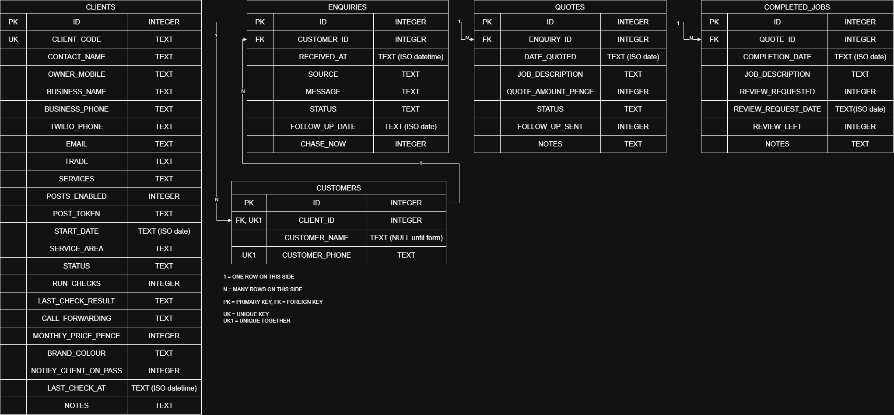

# Never Miss NI: database schema

A SQL practice project. I modelled the data behind a side project of mine, Never Miss NI, as a relational database so I could practise schema design and write real queries against it.

## Background

Never Miss NI is a pilot service for small trade businesses in Northern Ireland. When a tradesperson misses a call, the system texts the caller back, collects the enquiry through a short form, and later chases quotes and asks for reviews. Today the data lives in Google Sheets, with Make.com and Twilio doing the automation.

The sheets are built for the tradesperson to read, so they repeat information and have no enforced relationships. This repo models the same data as a normalised database, which is better suited to analysis. It is a model of the system, not a copy of it. All data in this repo is synthetic. There is no real client or customer data here.

## Schema

The editable source is `schema.drawio`.

| Table | What it holds |
|---|---|
| `clients` | The trade businesses that use the service: contact details, Twilio number, plan settings and system-check status. |
| `customers` | The people who ring a client. One row per phone number per client. |
| `enquiries` | Each enquiry from a customer: when it arrived, the source, the message, its status and the follow-up date. |
| `quotes` | Each quote given for an enquiry: amount, status and whether a follow-up was sent. |
| `completed_jobs` | Jobs that were finished, and whether a review was requested and left. |

Relationships, each one-to-many (the foreign key sits on the "many" side):

`clients` → `customers` → `enquiries` → `quotes` → `completed_jobs`

## Design decisions

- **Customers have their own table.** In the sheets, customer name and phone are repeated on three tabs. Here they live once in `customers`, and enquiries, quotes and jobs reach them through foreign keys. A quote and a job do not carry their own customer columns, because they can reach the customer through their enquiry.
- **Phone numbers are TEXT.** Spreadsheets strip the leading `+` from numbers. TEXT keeps them intact.
- **`customer_name` can be empty.** The text-back goes out when the call is missed, so the phone number is known before the caller has filled in the form.
- **Unique together:** `(client_id, customer_phone)`. The same number can be a customer of two different clients, but only once per client.
- **`id` is the primary key and `client_code` is unique.** I assign client codes such as `NM0001`, and they appear in short links. I considered using the code itself as the key. I chose an integer because the code is a business identifier that I might re-format later. Codes are never reused once a client leaves.
- **Dates and times are TEXT in ISO format** (`2026-10-22`, `2026-10-22 09:30:00`), because SQLite has no date type. ISO text sorts correctly and works with SQLite's date functions. The UK format (`22/10/2026`) does not sort correctly as text, so data must be converted before loading.
- **Money is stored as integer pence**, to avoid rounding errors.
- **Yes/no fields are INTEGER (0 or 1)**, because SQLite has no boolean type.

## Left out on purpose

The `Clients` tab in my control sheet has four columns that do not appear in the model: tracker sheet ID, tracker tab, enquiry form link, and short link. The first three exist only because each client currently has a separate Google Sheet, and the foreign keys replace that. The short link is built from the client code, so storing it would duplicate information.

Also not modelled: billing, costs, onboarding, posts and results. Another possible addition is a `texts_sent` table fed from Twilio logs. None of it is needed for the queries planned here.

## Known limitations

- `clients.services` holds a list in one cell. A separate `client_services` table would be the textbook fix, but it is not needed yet.
- `clients` mixes who the client is with how their service is set up (`posts_enabled`, `run_checks`, `call_forwarding`, `status`). A purist would split the settings into their own table.

## Open decisions

- `completed_jobs.quote_id` is allowed to be empty, because a small job may be completed without a formal quote.
- `job_description` appears in both `quotes` and `completed_jobs`. I kept both, because the work can change between the quote and the finished job.

## Next

1. Create the tables in SQLite and load about 300 rows of synthetic enquiries.
2. Funnel queries: enquiry to quote to won, by trade and by week.
3. Response time, chase conversion and repeat callers.
4. A second schema for manufacturing and ERP-style queries (orders, stock, purchase orders).

## Tools

SQLite, DB Browser for SQLite, draw.io.
